# YAVSOS: Yet Another Valheim Storage Organization System

You've played Valheim for a while now, so you know how it goes. You have chests everywhere
and an inventory full of items. Valheim asks you to open each chest one by one and stack
everything one chest at a time. It also asks you to manage hundreds of items and where each one
belongs. YAVSOS says, "Hold my beer." YAVSOS lets you assign chests a category, then gives
you the power to stash into every chest in the area with the press of a button. "But,
YAVSOS!" you exclaim. "What about items in chests that don't belong there?!" YAVSOS says,
"I got this." With another press of a button, every chest in the area magically reorganizes
according to its categories, filters and priorities.

You don't need to spend hours categorizing items; YAVSOS does it for you, using actual game
data and hints to work out which categories items belong in. Assigning a category also
anticipates items you haven't found yet and makes a home for them.

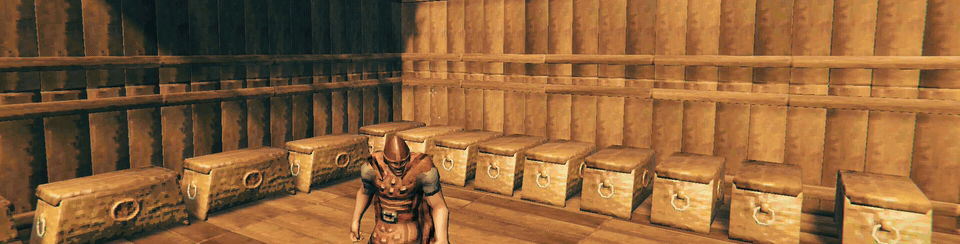

## AI Disclaimer
This project's codebase was written entirely by AI. If this deters you from wanting to use the project, I completely understand. I am not a coder. I've tried to become one many times and failed each time. It just doesn't work for me. That isn't a defense for my use of AI, it just is what it is.

With that being said, my involvement with this project is, and will continue to be, the design for every behavior, UI flow, feature, and function. Their implementation is a direct result of my choices. I can't read or understand the code; this means my friends/family and I test it by how it behaves.

I've put almost a month of time (at the time of writing this) into this project so far and plan to keep supporting it the only way I can. Bugs and issues will be addressed and fixed. I will read and listen to feature requests and weigh them against what I envision for the project, and how best to keep it something that helps or is useful to people.

This document has been written by myself, and not AI.

## Why YAVSOS?

We know there are so many other storage mods out there (hence the name), and what I saw is
that most of them tried, in a sense, to reinvent the wheel by building everything from
scratch: a stashing feature, maybe their own chest screen, multi-user chest logic and so on.

The problem with that is they end up replacing parts of other mods you trust or prefer, or
at worst, they're plainly incompatible or overlap a lot with them, forcing you to pick and
choose between a feature and your favorite mods.

YAVSOS attempts to go a different route. It works *with* the mods you already know and love,
and it goes to some lengths to keep them behaving exactly the way you expect them to.

- **Built with mod-to-mod collaboration in mind.** YAVSOS doesn't replace mods like
  AzuAutoStore (AAS); it tells AAS which chest each item belongs in, and AAS keeps doing what
  it does best. Your stashing still feels like AAS, because it still is.
- **Modest about other mods' settings.** When another mod already has a say, YAVSOS tries to
  respect it. For example, if AAS's config has exclusions for stashing, YAVSOS respects them,
  and the panel shows you which items they affect. Settings that belong to another mod stay
  in that mod, so there's only ever one place to change them.
- **Steps aside when you already have it.** YAVSOS comes with its own copy of MultiUserChest
  (MUC), for moving items into a chest another player has open. If you have the standalone
  mod, or the copy inside AzuAutoStore, YAVSOS uses that one instead. If you run only YAVSOS,
  our MUC adds protections that prevent item loss in certain situations.
- **Forward compatible.** YAVSOS never switches something off just because a version number
  changed. Each time the game starts, it checks the parts of other mods it actually relies
  on. If an update changes one of them, only that part turns off, everything else keeps
  working, and the panel tells you what happened.

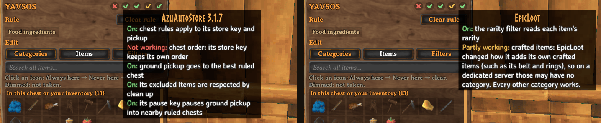

- **A communal effort!** When a mod YAVSOS works with has a gap, we'd rather work with its
  modder to see whether a fix belongs there than build a replacement. Anything we do have to
  work around is kept small, separate and easy to remove once it's no longer needed.

The way I see it, you shouldn't have to give up the mods you trust to get your storage
organized. YAVSOS should just fit in.

## Getting started

### Required mods
- **BepInEx**
- **Jotunn**

While this mod was designed to work with mods like **AzuAutoStore** (AAS), it is still optional. With AAS, YAVSOS leverages it to handle the stashing while YAVSOS supplies the rules. Without AAS, it uses its own stashing feature with similar feature parity, so it's up to you what you want to use; you don't have to sacrifice your comfort to use this mod. See [Stashing](#stashing).

### Gale

1. Select your Valheim profile.
2. Search for **YAVSOS** in the mod browser and press **Install**. Gale installs BepInEx and
   Jotunn along with it.
3. Optional: search for **AzuAutoStore** and press **Install**.
4. Press **Launch game**.

### r2modman

1. Select **Valheim** and your profile.
2. Go to **Online**, search for **YAVSOS**, select it and press **Download**. r2modman
   installs BepInEx and Jotunn along with it.
3. Optional: do the same for **AzuAutoStore**.
4. Press **Start modded**.

### Manual install

1. **BepInEx:** download **BepInExPack_Valheim** and copy everything inside its
   `BepInExPack_Valheim` folder into your Valheim folder, next to `valheim.exe`. To find that
   folder in Steam, right-click Valheim and choose **Manage → Browse local files**.
2. Start the game once and close it, so BepInEx creates its folders.
3. **Jotunn:** put `Jotunn.dll` in `BepInEx/plugins`.
4. **YAVSOS:** put the `YAVSOS` folder from the download in `BepInEx/plugins`, so you end
   up with `BepInEx/plugins/YAVSOS/YAVSOS.dll`.
5. Optional: put `AzuAutoStore.dll` in `BepInEx/plugins`.

### Servers

A Steam-hosted world needs nothing extra: the host installs YAVSOS like any other player.

For a dedicated server, install the same files into the server's folder, the one with
`valheim_server.exe`:

- BepInExPack_Valheim's contents go next to `valheim_server.exe`.
- `Jotunn.dll` and the `YAVSOS` folder (and `AzuAutoStore.dll` if you use it) go in the
  server's `BepInEx/plugins`.
- On Linux, start the server with `start_server_bepinex.sh` from BepInExPack. On Windows,
  start it the way you normally do.
- If your host has a mod or file manager, upload the same files to the same folders.

The server's YAVSOS settings live in its `BepInEx/config/com.bastionntb.yavsos.cfg`, and
they're sent to every player who joins.

## Setup types

| Setup | YAVSOS on | How it works |
| --- | --- | --- |
| **Single-player** | Your game | Everything, with your own categories and settings. |
| **Client and server** | The server and every player | The full setup. The server's categories and shared settings apply to everyone. |
| **Client only** | Your game, not the server | YAVSOS runs just for you. |
| **Server only** | The server, not the players | Not a working setup: players without YAVSOS can't join. |

- **Client and server.** This covers dedicated servers and Steam-hosted worlds, where the
  host acts as the server. YAVSOS is required: every player needs it, version 1.0.0 or later.
  A player without it can't join, and one with an older copy is told to update. Everyone shares the
  server's categories and settings, and while the shared settings are locked, only admins
  can change them.
- **Client only.** When you join a server that doesn't have YAVSOS, it notices and runs just
  for you, with your own categories and settings. Nobody else is affected, and you can still
  stash into other players' chests.
- **Server only.** Once the server has YAVSOS, it requires it from everyone. If some of your
  players can't or won't install it, leave it off the server; they can still use it client
  only.

## How it works

### Create rules in a chest

Open a chest, and the rule panel shows up beside it. Tick the categories you want it to accept, for example,
*Ores & metal scrap* or *Raw food*. YAVSOS rules are live as soon as you change them. Every item in those categories now belongs there, including ones you haven't found yet.

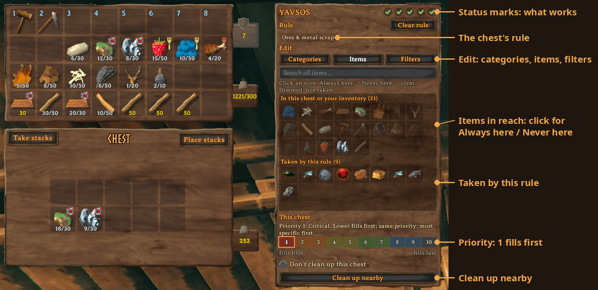

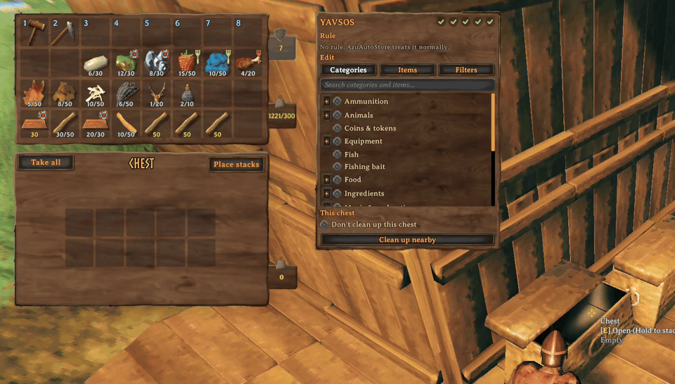

You can always clear a rule with a click of a button.

Rule editing respects the ward's permission settings when the chest is inside its area; a private chest can only be edited by the builder.

If you want more control:

- **Always or Never.** Under the "Items" tab, you can click an item's icon to mark it *Always*, meaning it will always be accepted there (even if it's not in the category), click again for *Never*, meaning it won't be stashed there (even if it is in the category). Click again to clear it, meaning it will follow the category and filters. This is so you can have fine-grained control over what goes into a chest or not.
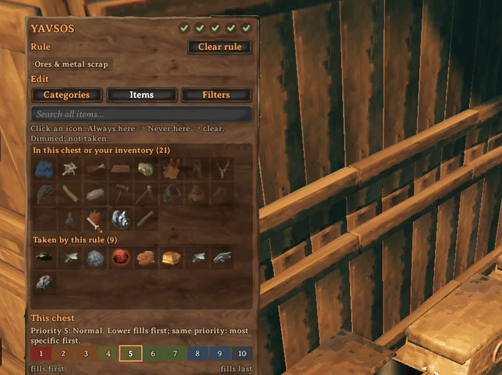
- **Filters.** Narrow things down, for example only upgraded gear, items crafted by you, an
  EpicLoot rarity, or food that's mostly health. The panel only offers filters that make
  sense for the items you picked.
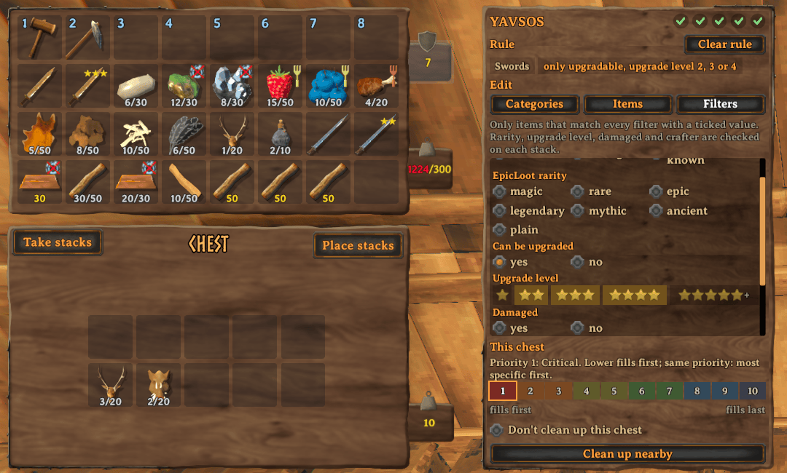
- **Priority.** When two chests are set to accept an item, you can set a priority rank on chests you want to accept the item first, then use others as a backup. Priority 1 (Critical) vs Priority 10 (Fuhgeddaboudit), with Priority 5 being normal.
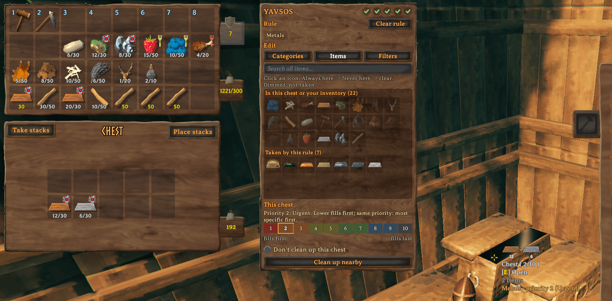

### Status marks

On the top right of the YAVSOS panel, you can find the status of integrations, if they are active or inactive, only if the companion mod is installed. Hover over each of the status icons in game to see explanations of exactly what's going on. Below is a general overview:

- Green means the integration is active.
- Amber/yellow means a partial failure or there is something you might need to look at, such as AAS exclusions for a chest or categories for a mod not working.
- Red X means a mod integration was disabled due to an automatic incompatibility check or functionality of YAVSOS is considered not working.
- Grey dash means a setting has been disabled.

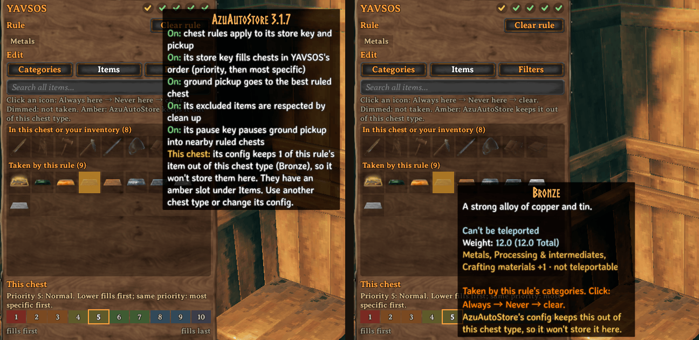

### Stashing

Stashing takes items from your inventory and automatically puts them into nearby chests for you. YAVSOS also directs where those items end up using rules you set up.

Press **.** (period) to stash everything in your inventory or **middle-click** a single stack/item in your inventory to
stash just that one. With AzuAutoStore (AAS) installed, YAVSOS defers to AAS for its stashing and you would use the AAS stash key as usual.

- **For chests with a rule:** Your items end up in the chests according to the rules that were set up, regardless of whether the item is already in the chest or not.

- **For chests without a rule:** The chest will accept items where existing items already match. (As is AAS's default behavior.)

Equipped items are never stashed. Items in your hotbar or AzuExtendedPlayerInventory (AzuEPI) quick slots are by default not stashed. These are configured through AAS when installed, or YAVSOS when standalone.

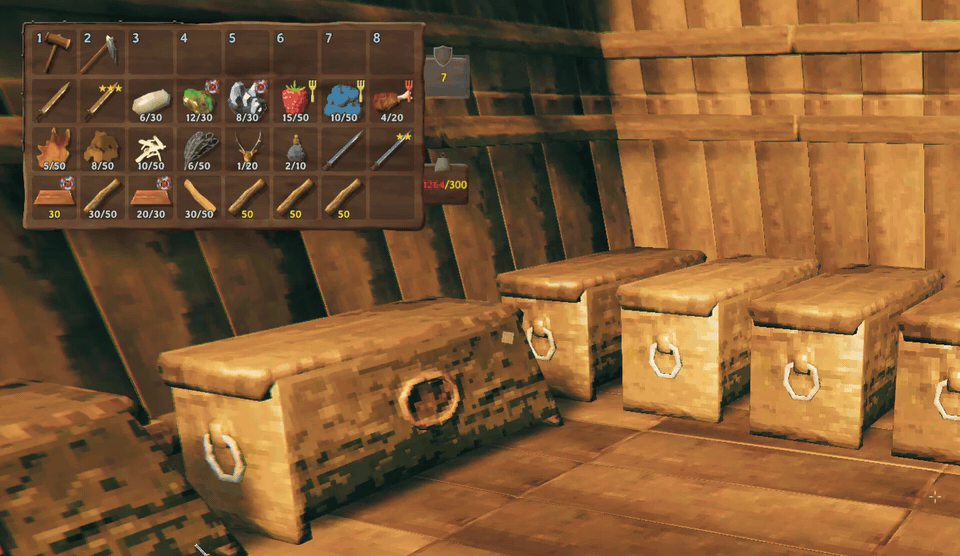

### Cleaning up

Sometimes people don't always stash things in the right place, or maybe you want to change the rules or priority on existing chests, or your critical supply chest has run out of items also stored in a lower-priority chest somewhere nearby. The cleanup function can help here!

It finds items that are better placed in other chests (rule mismatch, higher priority, etc.) and moves them to the place within the configured range. You can do this from the chest panel by clicking on **Clean up nearby** or by pressing **Ctrl + stash key** (default `.`, period). Afterwards, you will see a panel display informing you of what moved or stayed.

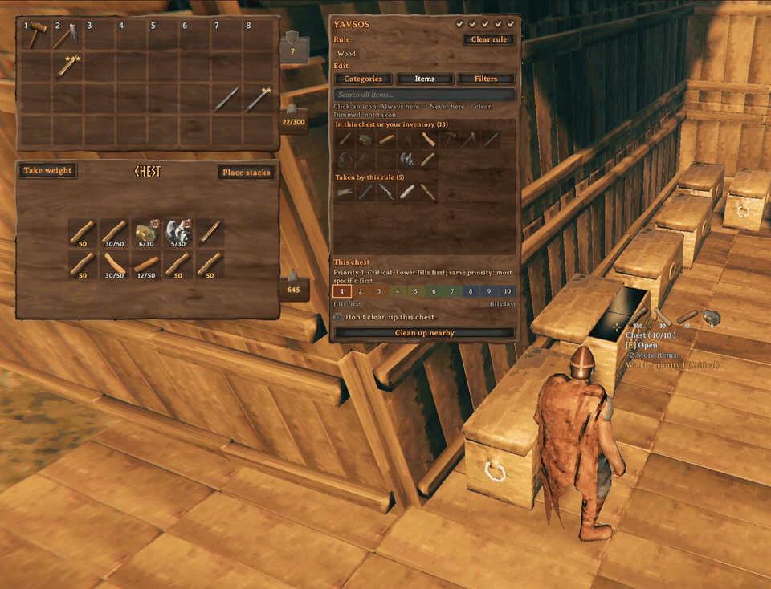

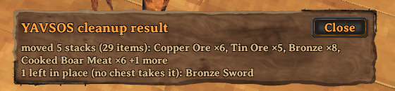

### Finding things

- Hover over a chest to see its rule, like "Food › eaten by Boar · priority 2 (Urgent)".
- Hover over an item in your inventory to see its categories and where stashing would send it.
- Search in the panel, and the nearby chests that would take that item light up.

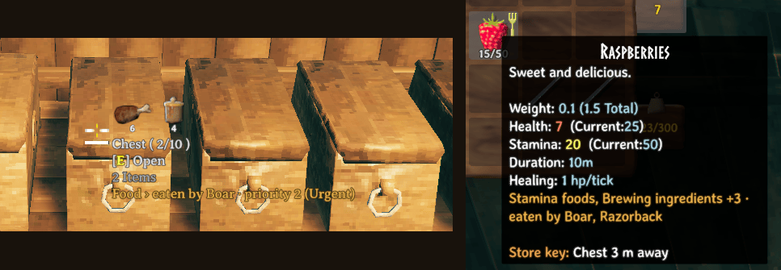

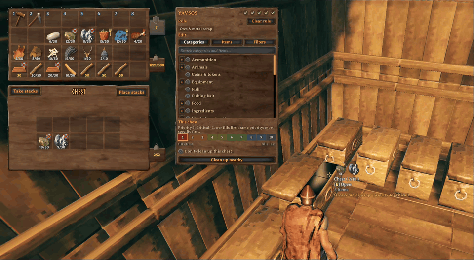

## Help and feedback

Everything goes through **GitHub issues**: bugs, questions, ideas and requests.

---

## Reference

### For server admins and modders
- [Settings](docs/SETTINGS.md): for a list of all settings and their defaults and much more.
- [Categories file](docs/MODDING.md): Want to add your own categories? Find out how here!

### For developers
- [Building from source](docs/BUILDING.md)
- [Contributing](CONTRIBUTING.md)
- [Design](docs/DESIGN.md): how YAVSOS works and why.
- [Changelog](CHANGELOG.md)

### Other mods in detail

- **AzuAutoStore:** every item still goes in through AzuAutoStore's own store call, so its
  messages, skip lists and multiplayer handling are unchanged. It matches stacks by name and
  quality, keeps your equipped items, hotbar, quick slots and favourites, and anything no
  rule asks for follows its own settings.
- **MultiUserChest:** moves into another player's chest follow MultiUserChest's own rules,
  including what happens if that player lags or leaves while a move is waiting. YAVSOS's copy
  refuses a move when it can't be sure the other player will read the item correctly.
- **EpicLoot:** YAVSOS reads its item definitions to filter by rarity. If a stack's rarity
  can't be read at that moment, a rarity filter doesn't take that stack.
- **RossItemDrawers:** drawers don't take YAVSOS rules, because the drawer's own item
  assignment already does that job. An empty drawer assigned to an item gets that item
  through AzuAutoStore.
- **The game's "Place stacks" button** works as it always has and doesn't follow rules.
- **Item origin:** the "from mod" filter knows items registered through Jotunn or
  ItemManager. Items a mod adds some other way show their origin as "not known".

Tested with AzuAutoStore 3.1.7, Jotunn 2.30.2, EpicLoot 0.15.4, RossItemDrawers 1.3.0 and
AzuExtendedPlayerInventory 2.6.4. During the testing, other mods were tested as well, but they won't be listed here; the mod is designed to generally be compatible by default. If specific compatibilities need to be expanded or made, create an issue on the GitHub for it!

## Licence and credits
YAVSOS is GPL-3.0-or-later ([LICENSE](LICENSE)). YAVSOS wouldn't work without the hard work of these modders and their mods: ServerSync by blaxxun and
MultiUserChest by MSchmoecker, both MIT ([notices](third_party/README.md)).
Built on Jotunn and BepInEx.